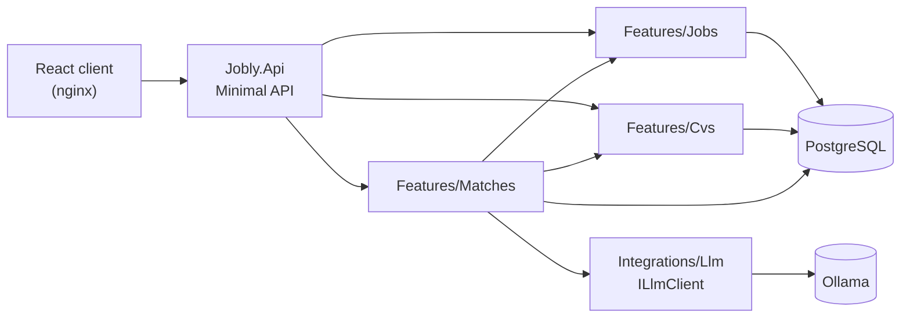

# Jobly

A job application tracker with a Kanban board, where a local AI model scores how well your CV matches each job. Built with a .NET 10 Minimal API, React and PostgreSQL.


> **Work in progress.** The job tracker is done. The AI matching works end to end, and I am now comparing local models to find the one that gives the best match quality.

<p align="center">
  <a href="https://github.com/user-attachments/assets/d02b8373-d29d-4da7-a781-fac8f67ef61c">
    
  </a>
</p>

---

## Highlights

- **AI CV matching.** Upload your CV (PDF or DOCX) and get a 0 to 100 match score, a summary, matching skills and gaps for any job.
- **Private by design.** The model runs locally with Ollama, so your CV never leaves your machine and nothing costs money.
- **Model-agnostic.** The model is a setting, not code. Switching models is one line in `docker/.env`, which makes it easy to compare them.
- **Vertical slice architecture.** One folder per feature, with the boundaries enforced by an architecture test.
- **Rich domain model.** Invalid jobs cannot be created, and the Kanban rules (which column can follow which) live in the domain.
- **Result pattern.** Expected failures are returned as `Result<T>` and mapped to ProblemDetails, not thrown as exceptions.
- **164 tests.** Unit tests for entities, services, the CV reader and the LLM client, plus integration tests for every endpoint.
- **One command to run.** Docker Compose starts the API, the React client and PostgreSQL.

---

## AI match result

<p align="center">
  <a href="https://github.com/user-attachments/assets/064db919-b080-41aa-be4e-c4a7722a250b">
    
  </a>
</p>

---

## Features

**Job tracking**
- Kanban board with 8 columns: Saved, Planning to apply, Applied, Interview, Offer, Rejected, Withdrawn and Ghosted
- Drag and drop between columns. Only valid moves are allowed (for example, nothing can follow Offer)
- Applied date set automatically the first time a job reaches Applied
- Notes on every job

**CV and AI matching**
- Upload a CV as PDF or DOCX, or paste the text
- Analyze a job: the model compares it with your CV and returns a score, summary, matching skills and gaps
- The latest result is saved per job, so you can come back to it

---

## How it works

### Architecture



| Folder | Responsibility |
|---|---|
| `Features/<Name>/` | One feature: entity, errors, DTOs, service, endpoints and EF configuration together |
| `Common/` | `Result` and `Error` types, Result to HTTP mapping, global exception handler |
| `Persistence/` | `JoblyDbContext` and migrations |
| `Integrations/Llm/` | Everything about the language model: contract, options, typed `HttpClient`, errors |

Slice rules:
- `Matches` may use `Jobs` and `Cvs`, because a match compares a job with the CV
- `Jobs` and `Cvs` must not use each other or `Matches`
- `SliceRulesTests` reads the source files and fails the build if a rule is broken

Features depend only on `ILlmClient`, so Ollama can be replaced by OpenAI or Azure OpenAI with one new class. Inside Ollama, the model is just a setting (`JOBLY_LLM_CHAT_MODEL`).

### AI matching

1. Load the job and the CV text
2. Build the prompt and send it to Ollama with a **JSON Schema**, so the model must answer in a fixed shape
3. Parse the answer. Prose, missing fields or a score outside 0 to 100 become a clean `InvalidResponse` error, not a crash
4. Replace the old result for that job in **one transaction**, so a failed save never loses the previous result

The `CancellationToken` flows from the browser to the database and the LLM, so closing the page stops the work.

### Domain model

```text
Saved           → PlanningToApply, Applied, Withdrawn
PlanningToApply → Applied, Withdrawn
Applied         → Interview, Rejected, Withdrawn, Ghosted
Interview       → Offer, Rejected, Withdrawn, Ghosted
Offer, Rejected, Withdrawn, Ghosted → (final)
```

- Private constructors and `Job.Create(...)` factories, so an invalid entity cannot exist
- No `_` fallback in the status switch, so adding a new status without a rule gives a build warning
- `TimeProvider` instead of `DateTime.Now`, so tests run with a fixed clock

### Security and privacy

- **Fallback authorization policy**: an endpoint that forgets to declare its access is closed, not open
- 5 MB request limit in Kestrel, plus file signature checks, so a file named `.pdf` must really be a PDF
- Logs never contain CV text or file names, only size and source
- Every error response is ProblemDetails with a trace ID for finding the logs
- Secrets live in `docker/.env`, which is gitignored

### Testing

| Project | What it covers |
|---|---|
| `Jobly.Api.UnitTests` (120 tests) | Entities, services with a real in-memory SQLite database, CV reader, LLM client with a fake `HttpMessageHandler`, EF model, slice rules |
| `Jobly.Api.Tests` (44 tests) | Every endpoint through `WebApplicationFactory`, error handling, the fallback auth policy |

### AI-assisted development with guardrails

The project is built with Claude Code, under rules I wrote:
- **Hooks** in `.claude/hooks/` run before every command and file change. They block deleting and ask before network, SQL or package changes
- **Rules** in `.claude/rules/` for architecture, testing, security, logging and Docker
- **A written plan** for every feature in `docs/plans/` before any code is written

---

## Tech stack

- **Backend:** C#, ASP.NET Core Minimal API, .NET 10, Entity Framework Core
- **Frontend:** React 19, TypeScript, Vite
- **Data:** PostgreSQL 17 (pgvector image), Npgsql
- **AI:** Ollama with JSON Schema structured output. Default model `qwen2.5:7b` while models are being compared
- **Documents:** PdfPig (PDF), DocumentFormat.OpenXml (DOCX)
- **Testing:** xUnit v3, `WebApplicationFactory`, SQLite in-memory
- **DevOps:** Docker Compose, nginx, central package management

---

## Getting started

**Requirements:** Docker Desktop, [Ollama](https://ollama.com), .NET 10 SDK, `dotnet tool install --global dotnet-ef`

```bash
git clone https://github.com/imaashishlk/jobly.git
cd jobly

# 1. Download a model once (Ollama runs on your machine, outside Docker)
#    The default is qwen2.5:7b. To try another, set JOBLY_LLM_CHAT_MODEL in docker/.env
ollama pull qwen2.5:7b

# 2. Settings: copy the example and set POSTGRES_PASSWORD and the same password in JOBLY_CONNECTION_STRING
cp docker/.env.example docker/.env

# 3. Start the stack (API, client, PostgreSQL)
docker compose -f docker/docker-compose.yml up -d --build

# 4. Create the tables
dotnet ef database update --project src/Jobly.Api --connection "Host=127.0.0.1;Port=48233;Database=jobly;Username=jobly;Password=YOUR_PASSWORD"
```

Open **http://127.0.0.1:48251**

Run the tests:

```bash
dotnet test
```

---

## Status and next steps

The job tracker and AI matching work end to end. Now in progress:

- **Choosing the model.** Comparing local models (Qwen, Gemma, Llama and others) on the same CV and jobs, looking at score quality, speed and how often the answer follows the schema
- **Better prompts**, based on what the comparison shows

Planned next:

- Sign-in, with each user seeing only their own jobs and CV
- Embeddings with pgvector: a quick match badge on every card and "best match first" sorting
- Import jobs from Arbeidsplassen (NAV)
- GitHub Actions CI and deployment to Azure

---

## Author

**Aashish Karki** · Stavanger, Norway · [LinkedIn](https://www.linkedin.com/in/imaashishkarki/) · [GitHub](https://github.com/imaashishlk)
